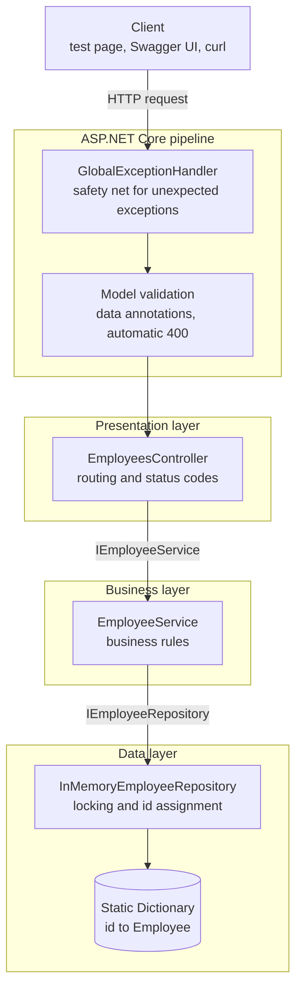
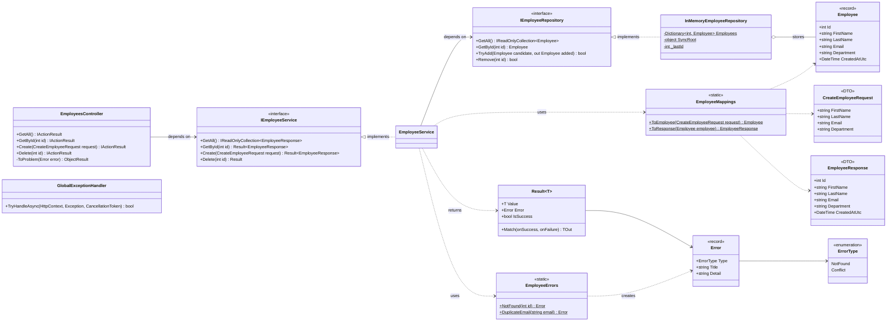
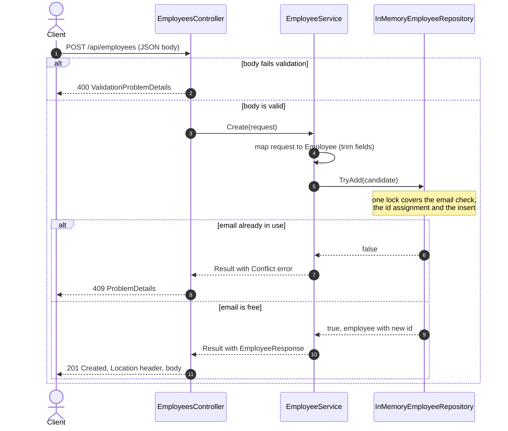
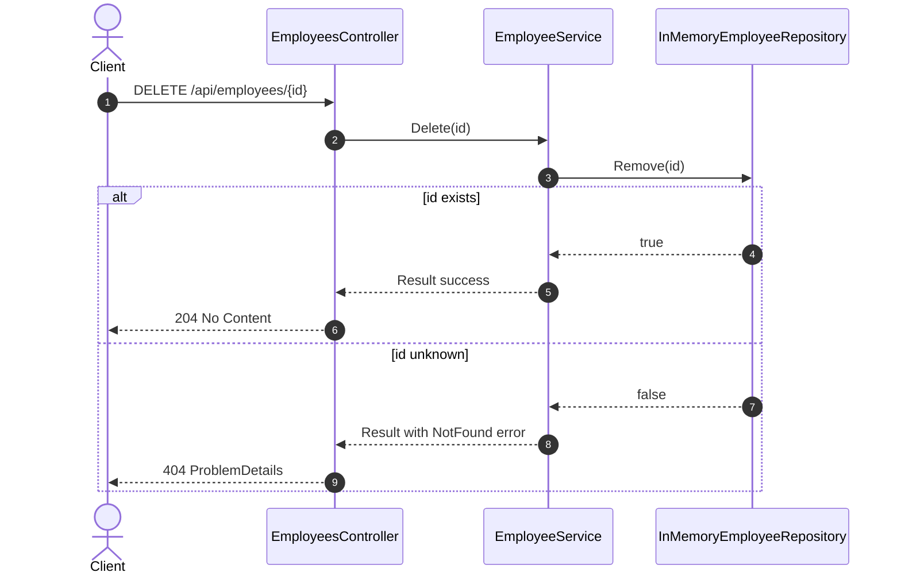
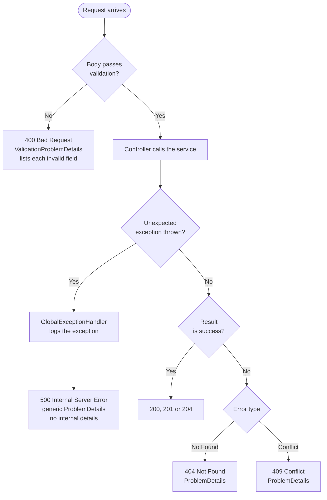
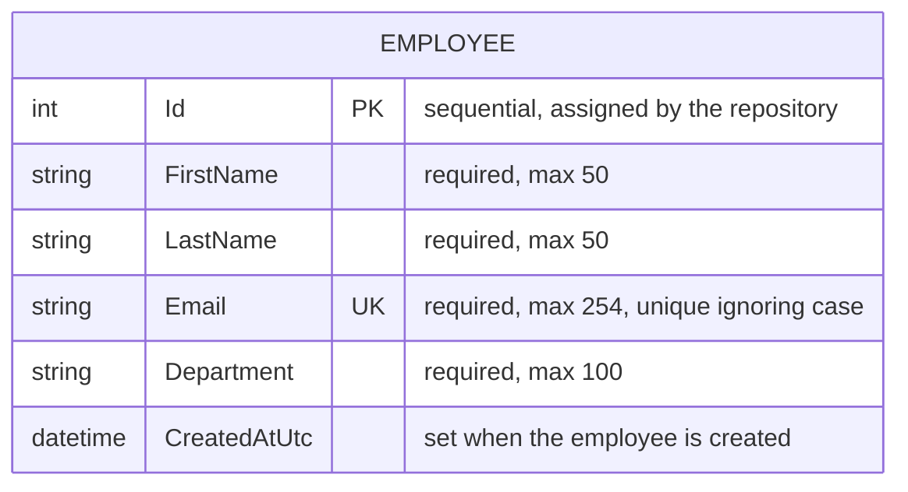
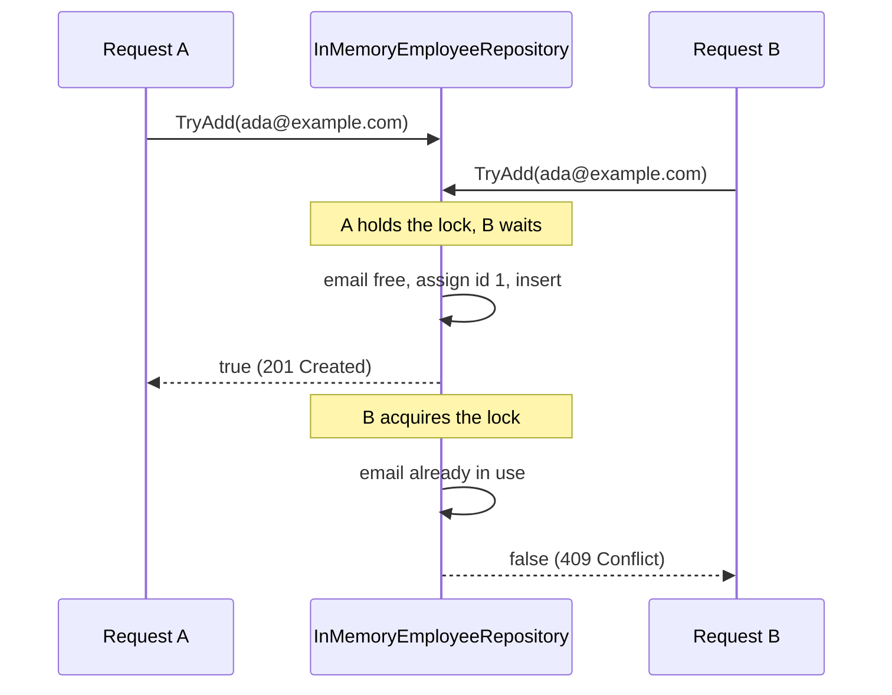
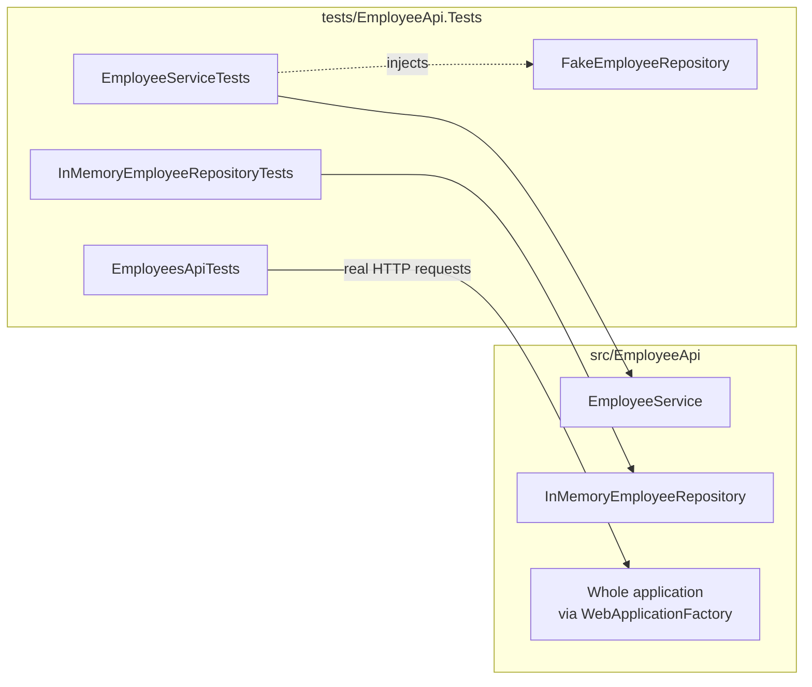

# Employee API design

This document describes how the Employee API is put together and why. For how to run and call
it, see [README.md](README.md).

The diagrams are written in Mermaid. They render on GitHub, Azure DevOps and GitLab, and in
Visual Studio or VS Code with a Mermaid preview extension.

## Contents

1. [Goals](#1-goals)
2. [Architecture overview](#2-architecture-overview)
3. [Class design](#3-class-design)
4. [Request flows](#4-request-flows)
5. [Error handling](#5-error-handling)
6. [Data model and storage](#6-data-model-and-storage)
7. [Concurrency](#7-concurrency)
8. [Testing strategy](#8-testing-strategy)
9. [Design decisions](#9-design-decisions)

## 1. Goals

| Requirement                         | How the design meets it                                              |
|-------------------------------------|----------------------------------------------------------------------|
| Expose employees as GET, POST, DELETE | `EmployeesController` on `/api/employees`                          |
| Store employees in a static collection | `InMemoryEmployeeRepository` holds a static dictionary            |
| Clean code and structure            | One responsibility per layer; each layer in its own folder           |
| Design patterns                     | Repository, service layer, dependency injection, DTO, Result         |
| Error handling                      | Validation, returned business errors, and a global exception handler |
| Unit testing                        | xUnit tests at service, repository and HTTP level                    |

## 2. Architecture overview

A request passes through three layers. Each layer knows only the interface of the layer below
it, and `Program.cs` wires the concrete classes together through dependency injection.

| Layer        | Folder            | Responsibility                                        | Knows about HTTP |
|--------------|-------------------|-------------------------------------------------------|------------------|
| Presentation | `Controllers/`    | Routes, status codes, turning errors into responses   | Yes              |
| Business     | `Services/`       | Rules such as "email must be unique"                  | No               |
| Data         | `Repositories/`   | Storing and retrieving employees, thread safety       | No               |

Supporting folders: `Models/` (the entity), `Contracts/` (request and response DTOs),
`Mapping/` (entity to DTO conversion), `Common/` (`Result` and `Error`), `ErrorHandling/`
(the global handler) and `wwwroot/` (the test page).

## 3. Class design

A non-generic `Result` (no value) also exists for operations such as `Delete` that either
succeed or fail with an `Error`.

## 4. Request flows

### 4.1 Create an employee (POST)

### 4.2 Delete an employee (DELETE)

### 4.3 Read employees (GET)

`GET /api/employees` returns every employee ordered by id; an empty store gives `200` with an
empty list. `GET /api/employees/{id}` follows the same shape as the delete flow: `200` with the
employee, or a `NotFound` result mapped to `404`.

## 5. Error handling

Errors are handled in three layers. Every one of them answers with an RFC 7807 ProblemDetails
body, so a client only has to understand one error format.

| Layer | Catches | Mechanism | Response |
|-------|---------|-----------|----------|
| 1. Input validation | Missing or malformed fields | Data annotations on `CreateEmployeeRequest`; `[ApiController]` rejects the request before the action runs | 400 |
| 2. Business failures | Unknown id, duplicate email | The service returns a `Result` carrying an `Error`; the controller maps `ErrorType` to a status code | 404, 409 |
| 3. Unexpected exceptions | Bugs and anything unforeseen | `GlobalExceptionHandler` (`IExceptionHandler`) logs the exception | 500 |

Expected failures are returned, not thrown. An unknown id or a duplicate email is a normal
outcome of a request, so it travels as a value. Exceptions are kept for real defects, which
means a failed request never stops the application and the debugger only breaks on something
that needs attention.

## 6. Data model and storage

- **Storage**: a `static Dictionary<int, Employee>` inside `InMemoryEmployeeRepository`. Being
  static, it is shared by every instance of the repository and lives as long as the process.
- **Ids**: a static counter incremented inside the lock. Ids start at 1, are never reused after
  a delete, and are not consumed by a rejected POST.
- **Immutability**: `Employee` is a record with init-only properties. The repository creates the
  stored copy with its id; nothing mutates an employee afterwards.
- **Lifetime**: all data is lost when the application restarts.

## 7. Concurrency

Web requests run in parallel, and a static collection is shared by all of them. Every read and
write goes through a single lock.

The important case is two simultaneous POSTs with the same email. `TryAdd` performs the
uniqueness check, the id assignment and the insert inside one lock, so the second request
always sees the first one's employee and is rejected.

A plain `Dictionary` with a lock was chosen over `ConcurrentDictionary` because the uniqueness
rule spans the whole collection: a check followed by an insert has to be atomic, and
`ConcurrentDictionary` only makes individual operations atomic.

## 8. Testing strategy

| Test class | Level | What it proves |
|------------|-------|----------------|
| `EmployeeServiceTests` | Unit | Business rules and returned errors, isolated by a per-test fake repository |
| `InMemoryEmployeeRepositoryTests` | Unit | Id assignment, duplicate-email rejection, deletes, and behaviour under concurrent inserts |
| `EmployeesApiTests` | Integration | Routing, validation, status codes and ProblemDetails over real HTTP |

Because the real store is static and shared between tests, tests that touch it use a unique
email per call and assert on their own employees, never on total counts.

## 9. Design decisions

| Decision | Reason | Trade-off |
|----------|--------|-----------|
| Repository behind an interface | The static collection can be replaced by a database without touching the service or controller | One extra abstraction for a small app |
| Separate service layer | Keeps business rules out of the controller and makes them testable without HTTP | More files than putting logic in the controller |
| DTOs separate from the entity | The API contract can change independently of the domain model; clients cannot set `Id` or `CreatedAtUtc` | A small mapping class to maintain |
| `Result` instead of exceptions for expected failures | Failure paths are visible in method signatures; no exception cost or debugger breaks for normal outcomes | Callers must handle the result explicitly |
| Global exception handler | One place guarantees a safe 500 and a log entry for anything unforeseen | None of note |
| Integer ids assigned by the repository | Easy to read and type; assignment is atomic with the insert | Ids reveal how many employees were created |
| Lock around a `Dictionary` | Makes the check-then-insert atomic | Requests queue briefly on the lock; fine at this scale |
| Repository registered as a singleton, service as scoped | The repository is stateless apart from its static store; the service follows the usual per-request lifetime | None of note |

### Extending the design

- **Database**: add a new `IEmployeeRepository` implementation and change one registration in `Program.cs`.
- **Update endpoint**: add `Update` to the service and repository, plus a PUT action; the `Result` and error mapping are reused as they are.
- **New error kinds**: add a value to `ErrorType` and one line to the controller's status-code mapping.
